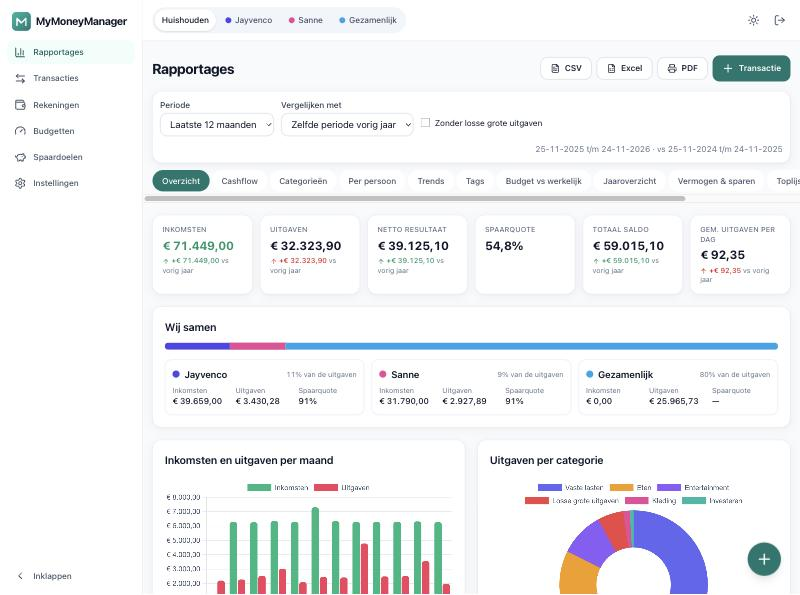
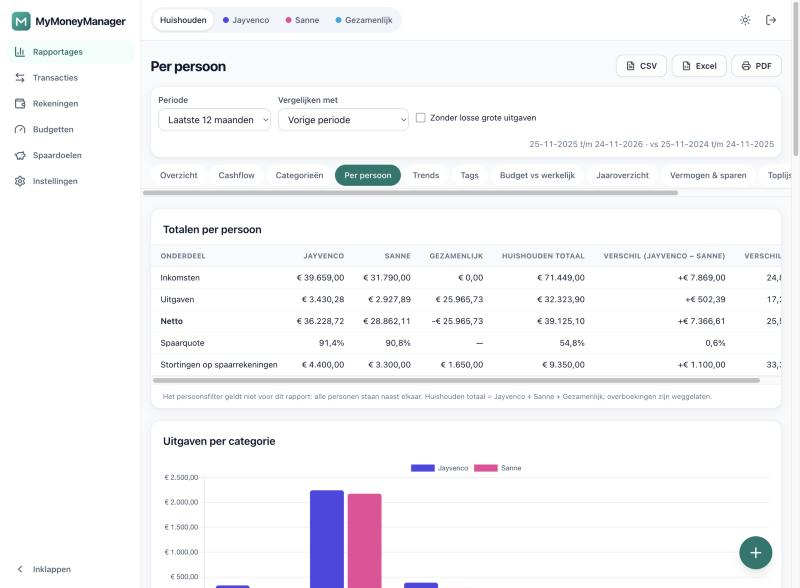
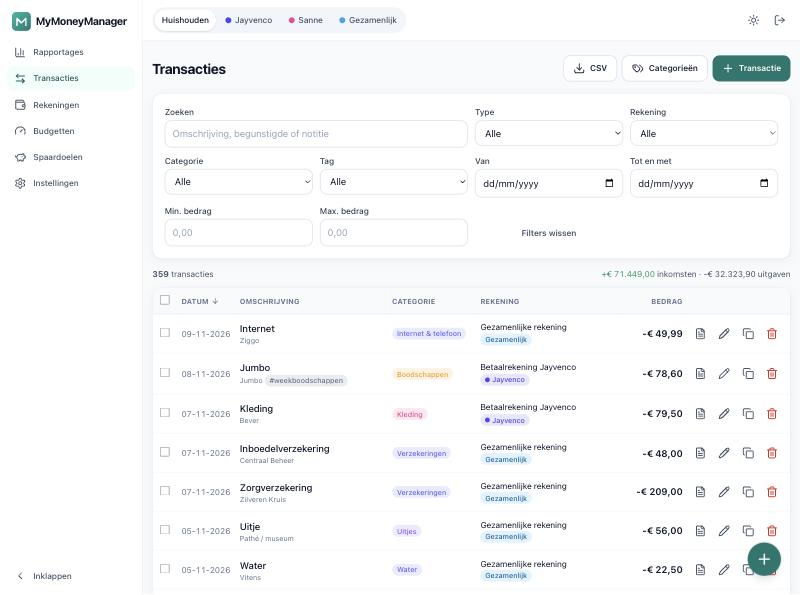
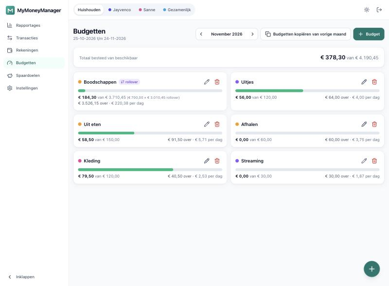
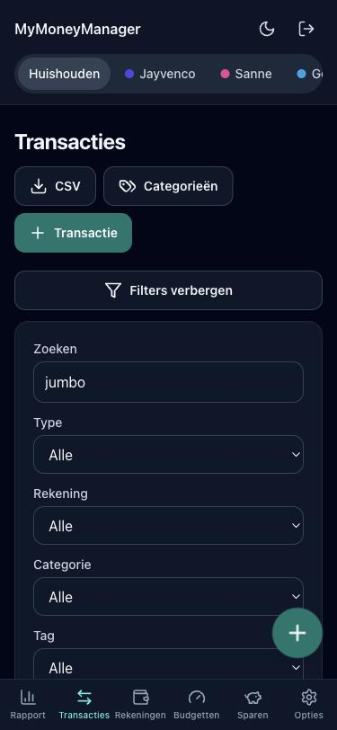

<p align="center"></p>

# MyMoneyManager

Zelf gehost huishoudboekje voor **twee partners**: inkomsten, uitgaven, budgetten, vaste lasten, spaardoelen en uitgebreide rapportages — met eigen rekeningen per persoon, gezamenlijke rekeningen en optionele privé-rekeningen. Eén Docker-container met SQLite, geheel in het Nederlands, bedoeld voor **Unraid** maar draait overal waar Docker draait. De app maakt **geen externe verbindingen**: alle assets zijn lokaal gebundeld.

> Rapportages zijn het startscherm. Overboekingen tussen rekeningen worden nooit als inkomsten of uitgaven geteld.

## Inhoud

- [Functies](#functies) · [Screenshots](#screenshots)
- [Installeren op Unraid](#installeren-op-unraid-stap-voor-stap) · [Docker Compose](#alternatief-docker-compose)
- [Configuratie](#configuratie) · [Back-up en herstel](#back-up-en-herstel)
- [Updaten](#updaten) · [Reverse proxy of Tailscale](#achter-een-reverse-proxy-of-via-tailscale)
- [Ontwikkelen](#ontwikkelen)

## Functies

- **Huishouden met twee leden** (+ gezamenlijk). Elke rekening heeft een eigenaar en is `gedeeld` of `privé`. Het persoonsfilter *Huishouden / lid 1 / lid 2 / Gezamenlijk* staat altijd bovenaan en wordt per gebruiker onthouden.
- **Privé-rekeningen** zijn onzichtbaar voor andere logins (niet-beheerders): in lijsten, rapportages, widgets, exports, tags en back-uplijsten. Eén centrale toegangscontrole filtert alle queries.
- **Transacties**: snel invoeren (knop `+` of toets `N`), inline bewerken, bulkacties, dupliceren, verwijderen met 10 seconden *Ongedaan maken*, filters in de URL, volledige wijzigingsgeschiedenis (audit-log).
- **Rekeningen** met saldo, sparkline en *Saldo controleren* (correctietransactie, standaard buiten rapportages).
- **Budgetten** per categorie en maand (standaard + overrides), optioneel per persoon, rollover en groen/oranje/rood-status.
- **Vaste lasten**: automatisch aanmaken of onder *Te bevestigen* in Rapportages; overzicht van de komende 30 dagen.
- **Spaardoelen** met voortgang, benodigde maandinleg en *op schema / achter*.
- **Rapportages** (11 stuks): Overzicht, Cashflow, Categorieën, **Per persoon** (verschillen tussen de partners in € en %, aandelen, bijdragen aan gezamenlijke rekeningen), Trends, Tags, Budget vs werkelijk, Jaaroverzicht, Vermogen & sparen, Toplijsten en Losse grote uitgaven. Perioden volgen de **financiële maand** (bijv. startdag 25), met vergelijking met de vorige periode of vorig jaar. Elk rapport is te exporteren als **CSV, XLSX en PDF** en heeft een deelbare URL.
- **Back-up en restore** (SQLite online backup API, veilig tijdens gebruik), automatische dagelijkse back-ups met retentie, volledige export (JSON/CSV) en **CSV-import** met presets voor ING, Rabobank en ABN AMRO en duplicaatdetectie.
- **Beveiliging**: Argon2-wachtwoorden, CSRF op elk formulier en HTMX-verzoek, inlog-rate-limit (5 per minuut), optionele TOTP-2FA, veilige cookies, de app draait nooit als root.
- **Mooi en snel**: licht/donker, responsive vanaf 360 px, bottom-navigatie op mobiel, installeerbaar als PWA, gzip en cache-headers.

Bewust **niet** inbegrepen: bankkoppelingen, OCR/bonnetjes, AI-functies en verrekenen tussen partners ("wie is wie geld schuldig"). Verschillen zie je alleen in de rapportages.

## Screenshots

| | |
|---|---|
|  |  |
| *Rapportages → Overzicht (startscherm)* | *Rapportages → Per persoon* |
|  |  |
| *Transacties met filters en inline bewerken* | *Budgetten met voortgang en rollover* |



*Mobiel, donker thema.* Alle screenshots komen uit het demo-huishouden (`flask seed-demo`).

## Installeren op Unraid (stap voor stap)

### 1. Image beschikbaar maken

Het image staat op GitHub Container Registry: `ghcr.io/jayvenco/mymoneymanager`.

* **Publieke repo/package** → Unraid kan het direct pullen, ga door naar stap 2.
* **Privé repo/package** → Unraid heeft eenmalig een login nodig:
  1. Maak op GitHub een **classic Personal Access Token** met alleen de scope `read:packages` (Settings → Developer settings → Tokens (classic)).
  2. Open de Unraid-terminal en log in:
     ```bash
     echo "<JOUW_PAT>" | docker login ghcr.io -u <JOUW_GITHUB_GEBRUIKERSNAAM> --password-stdin
     ```
  3. De login wordt bewaard in `/root/.docker/config.json`. Op Unraid staat `/root` in het RAM en verdwijnt bij een herstart. Maak het blijvend door na elke boot opnieuw in te loggen, bijvoorbeeld met de **User Scripts**-plug-in (schedule *At Startup of Array*) met bovenstaand `docker login`-commando, of kopieer `config.json` naar `/boot/config/` en kopieer het terug in `/boot/config/go`:
     ```bash
     mkdir -p /boot/config/docker-auth && cp /root/.docker/config.json /boot/config/docker-auth/
     # voeg toe aan /boot/config/go:
     mkdir -p /root/.docker && cp /boot/config/docker-auth/config.json /root/.docker/config.json
     ```
  Alternatief: maak de package openbaar (GitHub → Packages → mymoneymanager → Package settings → Change visibility).

### 2. Template installeren

```bash
mkdir -p /boot/config/plugins/dockerMan/templates-user
wget -O /boot/config/plugins/dockerMan/templates-user/mymoneymanager.xml \
  https://raw.githubusercontent.com/jayvenco/mymoneymanager/main/unraid/mymoneymanager.xml
```

(Bij een privé-repo werkt die URL niet zonder token; kopieer dan [`unraid/mymoneymanager.xml`](unraid/mymoneymanager.xml) handmatig naar die map, bijvoorbeeld via SMB naar `flash/config/plugins/dockerMan/templates-user/`.)

Ga in Unraid naar **Docker → Add Container**, kies bij *Template* **MyMoneyManager** en:

1. Vul **SECRET_KEY** in — genereer er een met `openssl rand -hex 32`. Zonder SECRET_KEY start de container bewust niet.
2. Controleer de paden:
   * `/mnt/user/appdata/mymoneymanager/data` → `/data`
   * `/mnt/user/appdata/mymoneymanager/backups` → `/backups`
3. Laat `PUID=99` en `PGID=100` staan (Unraid `nobody:users`). Alle bestanden op de host zijn dan van `nobody:users`.
4. Klik **Apply**.

**Sneller:** het script `scripts/install-unraid.sh` doet stap 2 voor je (mappen, SECRET_KEY, template voor de Docker-tab en de container):

```bash
curl -fsSL https://raw.githubusercontent.com/jayvenco/mymoneymanager/main/scripts/install-unraid.sh -o /tmp/install-mmm.sh && bash /tmp/install-mmm.sh
```

### 3. Eerste keer starten

Open `http://<unraid-ip>:8708`. De **setup-wizard** verschijnt binnen ongeveer 30 seconden:

1. Maak je beheerder-login en profiel.
2. Geef het huishouden een naam en voeg je partner toe (geen login nodig).
3. Kies de startdag van de financiële maand (bijv. 25 als je salaris op de 25e komt).
4. Voeg je rekeningen toe (eigen, partner en gezamenlijk) met beginsaldo — of sla over.
5. De standaardcategorieën worden aangemaakt. Daarna is `/setup` voorgoed uitgeschakeld.

Wil je de app eerst uitproberen? `docker exec -it mymoneymanager flask seed-demo` werkt op een **lege** database en maakt een demohuishouden (`demo` / `demo-wachtwoord-1`). Gebruik dat nooit in productie.

### SQLite op Unraid: let op

* Houd de `appdata`-share op de **cache/pool**, bij voorkeur als **exclusive share**. Je kunt ook direct `/mnt/cache/appdata/mymoneymanager/...` mappen.
* Reden: dit vermijdt de FUSE-laag (`shfs`) van `/mnt/user`, die voor extra overhead en problemen met WAL-locking kan zorgen.
* Neem `/mnt/user/appdata/mymoneymanager/backups` op in de **Appdata Backup**-plug-in of een offsite sync, zodat back-ups ook buiten de server staan.

## Alternatief: Docker Compose

Voor de Unraid *Compose Manager*-plug-in of lokaal testen:

```bash
cp .env.example .env        # vul SECRET_KEY in
docker compose up -d
```

[`docker-compose.yml`](docker-compose.yml) gebruikt dezelfde paden en `restart: unless-stopped`. Voor een lokale test kun je de paden in het bestand vervangen door `./data:/data` en `./backups:/backups`.

## Configuratie

Alle instellingen gaan via omgevingsvariabelen (zie [`.env.example`](.env.example)).

| Variabele | Standaard | Omschrijving |
|---|---|---|
| `SECRET_KEY` | — **verplicht** | Geheime sleutel voor sessies/CSRF. De app weigert te starten zonder. `openssl rand -hex 32` |
| `TZ` | `Europe/Amsterdam` | Tijdzone (o.a. voor het tijdstip van back-ups) |
| `PUID` / `PGID` | `99` / `100` | Gebruiker/groep waaronder de app draait (Unraid `nobody:users`) |
| `UMASK` | `022` | Umask voor nieuwe bestanden |
| `HTTPS` | `false` | `true` achter HTTPS: Secure-cookies en HSTS |
| `SESSION_LIFETIME_DAYS` | `7` | Geldigheid van een login in dagen |
| `BACKUP_TIME` | `03:00` | Standaardtijdstip van de automatische back-up (aanpasbaar in de app) |
| `BACKUP_FREQUENCY` | `monthly` | `daily`, `weekly` of `monthly` (ook in de app instelbaar) |
| `BACKUP_RETENTION_DAYS` | `360` | Automatische back-ups ouder dan dit aantal dagen worden verwijderd |
| `LOG_LEVEL` | `INFO` | `DEBUG`, `INFO`, `WARNING` of `ERROR` (JSON-logs naar stdout) |

Volumes: `/data` (database) en `/backups`. Poort: `8708`. Healthcheck: `GET /health`.

## Back-up en herstel

**Back-up maken** — *Instellingen → Back-up, import en export*:

* *Download back-up*: een `.zip` met een consistente databasekopie (online backup API, veilig tijdens gebruik) en `manifest.json` (appversie, schemaversie, tijdstip, aantal records per tabel).
* *Automatisch*: standaard **maandelijks** (de eerste keer na het ingestelde tijdstip in een nieuwe maand) naar `/backups`, en **360 dagen bewaard**. Frequentie (dagelijks/wekelijks/maandelijks), tijdstip en bewaartermijn zijn in de app instelbaar. De nieuwste automatische back-up blijft altijd staan; handmatige en veiligheidskopieën worden nooit automatisch verwijderd.

**Herstellen** (alleen beheerder):

1. Upload een back-upzip (of kies er een uit de geschiedenis).
2. De app valideert manifest, schemaversie en database-integriteit en toont een samenvatting.
3. Na bevestiging maakt de app eerst een **veiligheidskopie** van de huidige gegevens.
4. Daarna herstelt ze de database en voert zo nodig migraties uit. Je logt opnieuw in.

Herstellen op een **nieuwe container**: start de container met een lege `/data`, doorloop de wizard (of niet nodig: de restore vervangt alles) en herstel de zip. Er gaat niets verloren.

**Overig**: *Volledige export* (JSON of CSV per tabel; zonder wachtwoordhashes en 2FA-geheimen) en **CSV-import** (kies rekening → upload → kolommen koppelen → voorbeeld met duplicaatdetectie → importeren). Presets: ING, Rabobank, ABN AMRO.

## Updaten

1. Push naar `main` → GitHub Actions test en bouwt `ghcr.io/jayvenco/mymoneymanager:latest`.
2. In Unraid: **Docker → Check for Updates → Apply Update**.
3. Bij het starten worden databasemigraties automatisch uitgevoerd; maak voor de zekerheid vooraf een back-up.

Liever vaste versies? Gebruik de tag `1.0.0` (of `1.0`, `1`) in plaats van `latest`. Tags `vX.Y.Z` in git publiceren automatisch versie-images.

## Achter een reverse proxy of via Tailscale

Zet `HTTPS=true` zodra de app via HTTPS bereikbaar is. De app respecteert `X-Forwarded-For/Proto/Host`.

**Nginx Proxy Manager**: Proxy Host → *Forward Hostname/IP* = Unraid-IP, *Forward Port* = `8708`, SSL-certificaat aanvragen, *Force SSL* aan, *Websockets* niet nodig.

**SWAG** (`/config/nginx/proxy-confs/mymoneymanager.subdomain.conf`):

```nginx
server {
    listen 443 ssl;
    server_name geld.*;
    include /config/nginx/ssl.conf;
    location / {
        include /config/nginx/proxy.conf;
        include /config/nginx/resolver.conf;
        set $upstream_app mymoneymanager;
        set $upstream_port 8708;
        set $upstream_proto http;
        proxy_pass $upstream_proto://$upstream_app:$upstream_port;
    }
}
```

**Caddy**:

```caddyfile
geld.voorbeeld.nl {
    reverse_proxy mymoneymanager:8708
}
```

**Tailscale**: installeer Tailscale op de Unraid-server en open `http://<tailscale-naam>:8708`, of publiceer met `tailscale serve --bg 8708` voor HTTPS (`HTTPS=true`). Zo hoeft er geen poort naar het internet open.

## Ontwikkelen

Vereist Python 3.12 en Node (alleen voor Tailwind).

```bash
python3.12 -m venv .venv && .venv/bin/pip install -r requirements-dev.txt
npm ci && npm run build            # Tailwind-CSS en vendored JS naar app/static
export SECRET_KEY=dev DATA_DIR=$PWD/.devdata BACKUP_DIR=$PWD/.devdata/backups
.venv/bin/flask --app wsgi:app db upgrade
.venv/bin/flask --app wsgi:app seed-demo            # optioneel: demodata
FRESH=0 scripts/dev.sh                                # http://127.0.0.1:5055
.venv/bin/ruff check . && .venv/bin/ruff format --check . && .venv/bin/pytest
```

Structuur: `app/blueprints/*` (routes), `app/services/*` (businesslogica: toegangscontrole, saldi, budgetten, rapportages, back-up, import), `app/models.py`, `migrations/`, `tests/`. Bedragen zijn altijd integer cents; alle aggregaties gebeuren in SQL. CI draait ruff, pytest, een Docker-build en een shell-test van de PUID/PGID-afhandeling.

## Licentie

MIT — zie [LICENSE](LICENSE).
